<div align="center">


# KTMnav

### Turn-by-turn navigation on your KTM &amp; Husqvarna TFT dashboard

A free Android app that sends turn-by-turn directions from **Google Maps, Waze, OsmAnd, Kurviger, Calimoto** and more to compatible **KTM and Husqvarna** motorcycle dashboards over Bluetooth. It also includes handlebar shortcuts, call control, GPX ride recording and read-only OBD-II.

**No accounts. No ads. No subscriptions. No cloud.**


<a href="https://github.com/geekyshubham/KTMnav/releases/latest/download/KTMnav-1.5.0.apk"></a>
&nbsp;
<a href="https://github.com/geekyshubham/KTMnav/releases"></a>

<a href="docs/media/ktmnav-launch-video.mp4">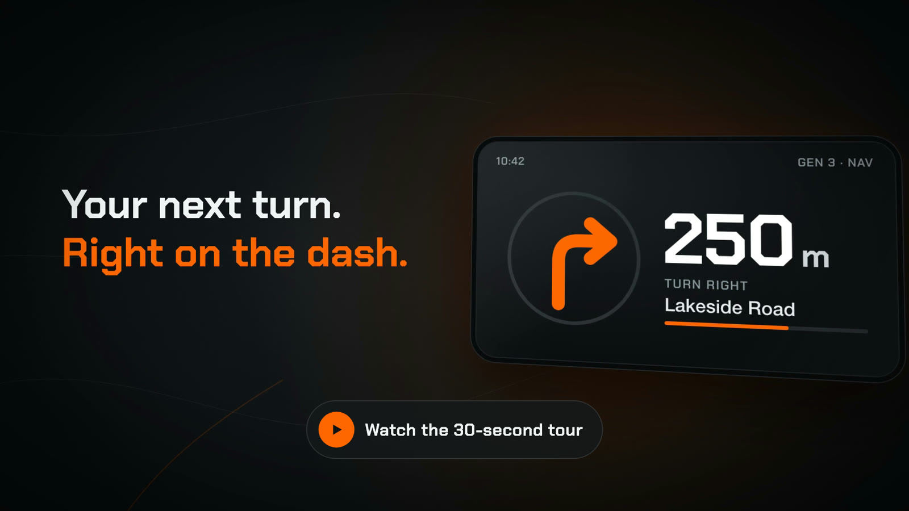</a>

<sub>▶ Click the image to watch the full 30-second tour (MP4, with sound)</sub>

[Download](#-install--set-up) · [Features](#-features) · [Screenshots](#-screenshots) · [Navigation apps](#-supported-navigation-apps) · [FAQ](#-faq) · [Build](#-build-from-source)

</div>

---

## 🎬 Quick look


https://github.com/user-attachments/assets/bf5d8fdd-995b-4ea5-a43b-3aa4d61908a6


## 🏍️ What is KTMnav?

KTMnav is an independent **KTM navigation app** for Android. It puts turn-by-turn guidance from your phone's navigation app on the **TFT display** of compatible KTM and Husqvarna motorcycles, such as the Gen 3 **KTM 390 Duke** and **390 Adventure**, and other bikes with Gen 2 or Gen 3 connectivity dashboards.

You keep using the navigation app you already like. KTMnav reads its guidance and sends each turn arrow, distance and street name to your dash, so you don't need a phone mount.

| | |
|---|---|
| **Gen 3 dashboards** | Encrypted Bluetooth LE (BCCU) link with automatic fast reconnect |
| **Gen 2 dashboards** | Bluetooth Classic (RFCOMM) |
| **Phone** | Android 12L (API 32) or newer |
| **Cost** | Free. Every feature included, no in-app purchases |
| **Privacy** | Runs on your phone. No account, analytics, ads or backend server |

## ✨ Features

<table>
<tr>
<td width="50%" valign="top">

### 🧭 Navigation on the dash
- Turn arrows, distances and street names on your TFT
- **Navigate from KTMnav.** Type a place, address, coordinates or a Google Maps link, pick an app, tap **Go**
- Favourites (Home, Work and more), recent destinations, places shared from other apps and `geo:` links
- Optional **two-wheeler routing** for Google Maps
- **Dashboard preview** on the phone, clearly labelled and never sent to the bike

</td>
<td width="50%" valign="top">

### 🗺️ Planned routes (GPX)
- Import **GPX routes** from Kurviger, Calimoto or any route planner
- Open GPX files straight from a file manager
- See the trace, distance, elevation gain and track points
- **Navigate this route** in your chosen app. Google Maps gets the start, up to nine of the sharpest bends, and the end

</td>
</tr>
<tr>
<td valign="top">

### 🎛️ Handlebar controls (Gen 3)
- Map **UP / DOWN / SET / BACK** to phone actions
- **Tap, double tap and long press** on each button
- Music, Controller, Custom and Off modes
- Scroll, select, Back, play/pause, volume, open your navigation app

</td>
<td valign="top">

### 📞 Calls &amp; messages
- **SET answers, BACK silences** a ringing call
- Caller name on the dashboard
- Optional **message banners** (WhatsApp, Telegram, Signal, Google Messages and more)
- Track-change banners for your music

</td>
</tr>
<tr>
<td valign="top">

### 📈 Ride tools
- **GPX ride recording** with speed-coloured track and ride stats
- **Turn beeper** that beeps faster as the turn gets closer
- **GPS speed alert** with a tone and a dash alert
- Save a waypoint and come back to it

</td>
<td valign="top">

### 🔧 Garage &amp; diagnostics
- Save **multiple motorcycles** with silhouettes for 8 styles
- Auto-connect and background bridge
- **Read-only OBD-II** through an ELM327 adapter: live data, fault codes, learned gear estimate
- Dashboard **symbol test and turn-icon calibration**

</td>
</tr>
<tr>
<td colspan="2" valign="top">

### 🎨 Made for riders
**KTM orange**, **Husqvarna blue** and **daylight** themes · **7 languages** (English, Deutsch, Español, Français, Italiano, Português BR/PT) · large-text, landscape and tablet layouts · large 48 dp touch targets

</td>
</tr>
</table>

## 📱 Screenshots

<div align="center">

| Navigate | Dashboard preview | Navigation apps | Garage |
|:---:|:---:|:---:|:---:|
| 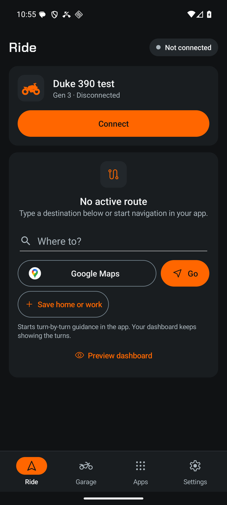 | 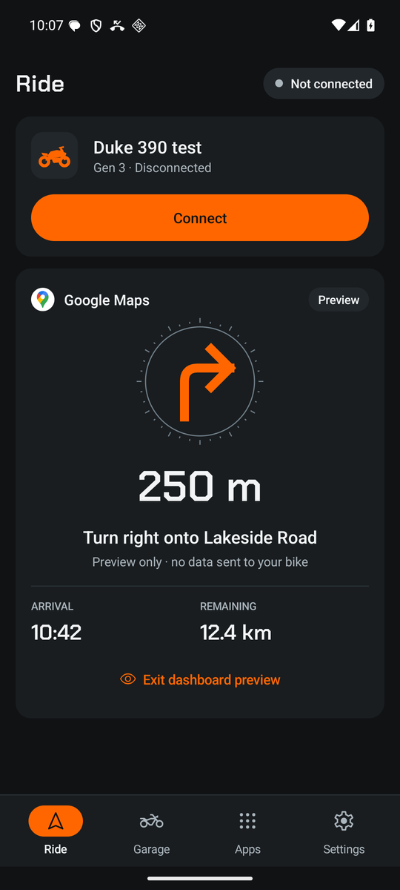 | 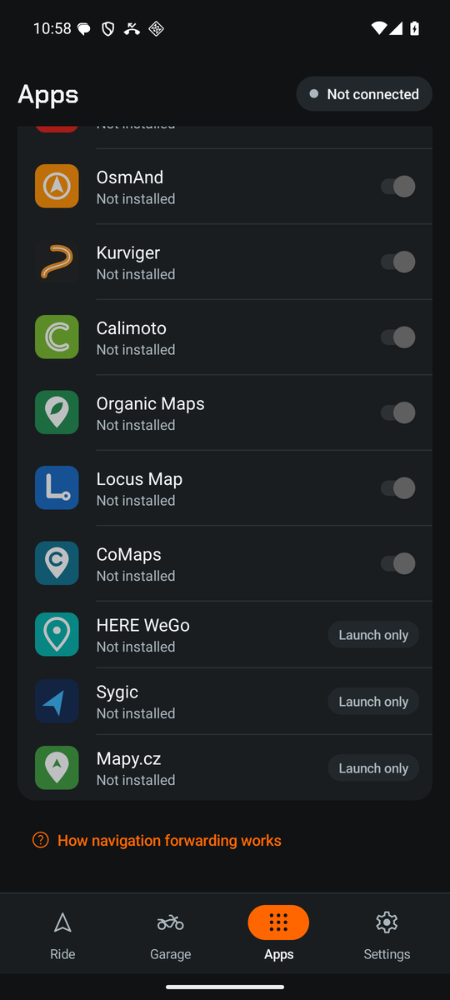 | 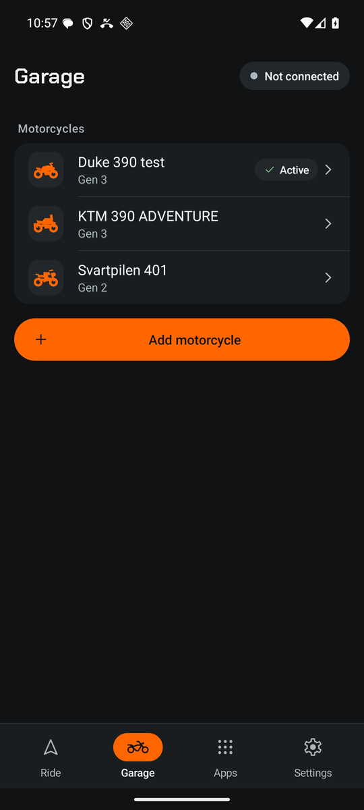 |

| Handlebar buttons | Calls | Messages on dash | Ride tools |
|:---:|:---:|:---:|:---:|
| 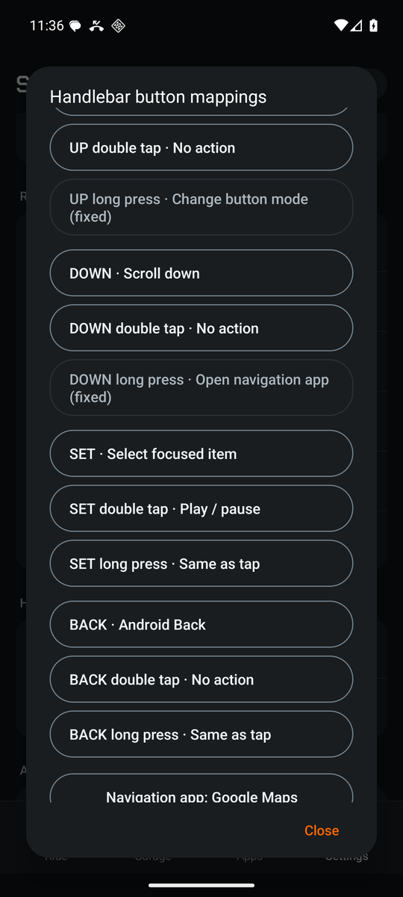 | 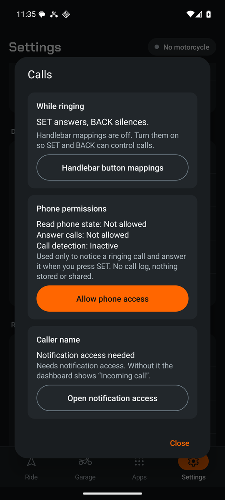 | 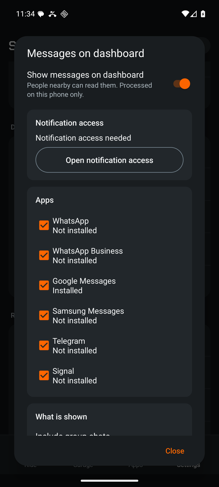 | 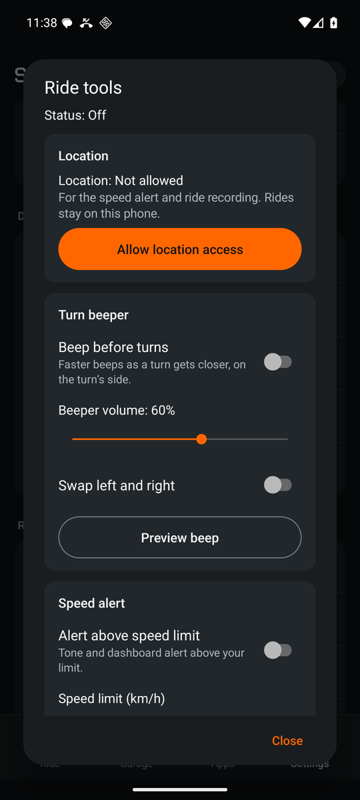 |

| GPX ride recording | Planned GPX route | OBD-II adapter | Symbol test |
|:---:|:---:|:---:|:---:|
| 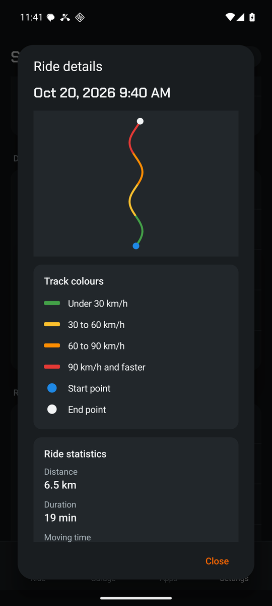 | 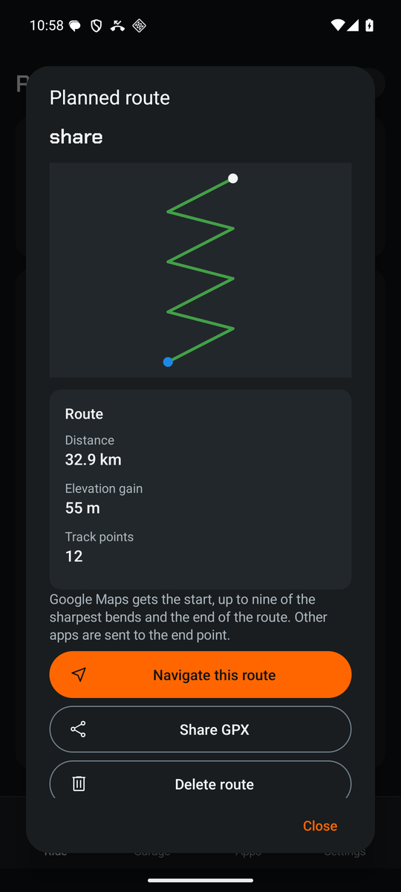 | 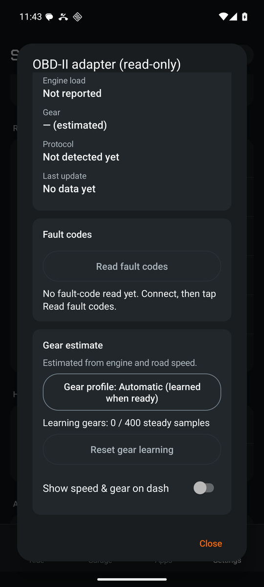 | 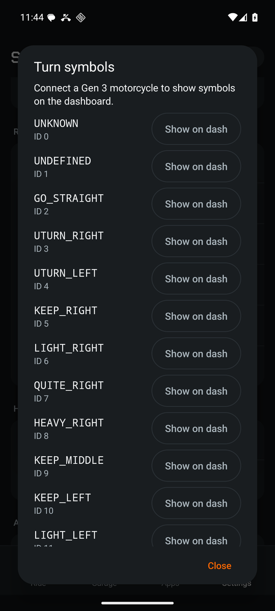 |

| Husqvarna theme | Daylight theme | Motorcycle model | Settings |
|:---:|:---:|:---:|:---:|
| 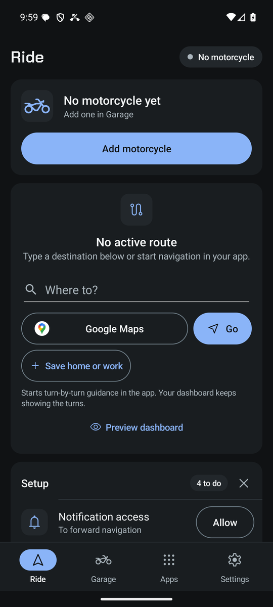 | 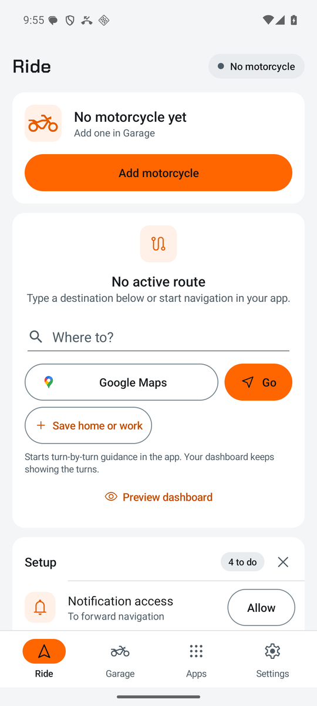 | 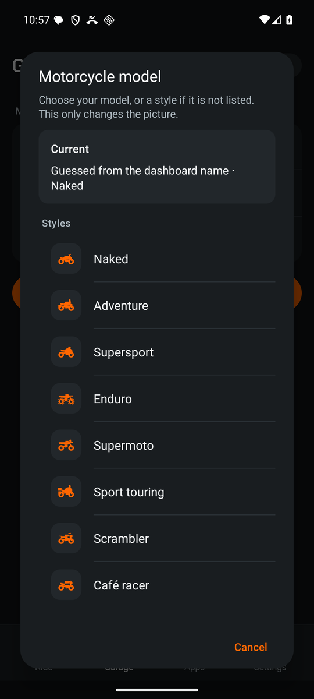 | 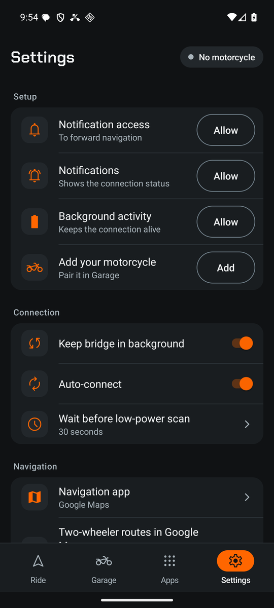 |

</div>

## 🧭 Supported navigation apps

| App | Turns on your dash | Start from KTMnav |
|---|:---:|:---:|
| Google Maps | ✅ | ✅ |
| Waze | ✅ | ✅ |
| TomTom GO | ✅ | ✅ |
| OsmAnd / OsmAnd+ | ✅ | ✅ |
| Kurviger | ✅ | ✅ |
| Calimoto | ✅ | ✅ |
| Organic Maps | ✅ | ✅ |
| Locus Map | ✅ | ✅ |
| CoMaps | ✅ | ✅ |
| HERE WeGo | — | ✅ |
| Sygic | — | ✅ |
| Mapy.cz | — | ✅ |

> Third-party navigation apps keep their own terms, fees and subscriptions. KTMnav doesn't unlock or bypass anything in other apps.

## 🚀 Install &amp; set up

1. **Download [`KTMnav-1.5.0.apk`](https://github.com/geekyshubham/KTMnav/releases/latest/download/KTMnav-1.5.0.apk)** from [Releases](https://github.com/geekyshubham/KTMnav/releases) on an Android 12L+ phone and open it. Allow installing from your browser if Android asks. A Google Play release is in testing.
2. Open KTMnav and allow **Nearby devices**.
3. Turn on KTMnav in Android **Notification access**. This lets it read navigation guidance.
4. Switch on your motorcycle, then go to **Garage → Scan for motorcycles** and save your bike.
   - **Gen 3:** open the dashboard's Bluetooth menu for the first pairing prompt.
   - **Gen 2:** pair in Android Bluetooth settings and turn on *Navigation* in the dashboard Bluetooth menu.
5. Start navigation in a supported app, or type a destination on the **Ride** tab and tap **Go**.

The **Setup** checklist in the app shows only the steps you haven't done yet. Do pairing and permissions while parked.

## ❓ FAQ

<details>
<summary><b>How do I get Google Maps navigation on my KTM TFT dashboard?</b></summary>

Install KTMnav, allow notification access, pair your bike in Garage, and start Google Maps navigation (or type a destination in KTMnav and tap Go). The turn arrow, distance and street appear on your compatible Gen 2 or Gen 3 dashboard.
</details>

<details>
<summary><b>Does it work with the KTM 390 Duke, 390 Adventure or Husqvarna Svartpilen?</b></summary>

KTMnav targets KTM and Husqvarna bikes with **Gen 2** (Bluetooth Classic) or **Gen 3** (encrypted Bluetooth LE) connectivity dashboards, including the Gen 3 390 Duke. Support depends on your dashboard generation and firmware. Use **Settings → Dashboard symbol test** while parked to see what your dash shows. See [docs/VERIFICATION.md](docs/VERIFICATION.md) for exactly what has been tested.
</details>

<details>
<summary><b>Can I use Waze, OsmAnd, Kurviger or Calimoto instead of Google Maps?</b></summary>

Yes. Nine apps forward turns to the dash: Google Maps, Waze, TomTom GO, OsmAnd, Kurviger, Calimoto, Organic Maps, Locus Map and CoMaps. HERE WeGo, Sygic and Mapy.cz can be started from KTMnav but don't forward turns.
</details>

<details>
<summary><b>Is it really free? Do I need an account?</b></summary>

Yes, it's free, with no account, ads, subscriptions, analytics or server. Everything runs on your phone. Data goes only to your paired motorcycle over Bluetooth, and GPX files leave the phone only when you export them.
</details>

<details>
<summary><b>Can I ride a planned route from Kurviger or Calimoto?</b></summary>

Yes. Import the GPX file in **Rides → Planned routes** (or open it from a file manager) and tap **Navigate this route**.
</details>

<details>
<summary><b>Can KTMnav control cruise control or other vehicle functions?</b></summary>

No. KTMnav receives handlebar button presses and sends display data. It doesn't control the vehicle. OBD-II support is read-only.
</details>

## 🛠️ Build from source

Requirements: **JDK 17**, **Android SDK 36**. Set `sdk.dir` in `local.properties` or `ANDROID_HOME`.

```sh
git clone https://github.com/geekyshubham/KTMnav.git
cd KTMnav
./gradlew :app:assembleDebug :app:testDebugUnitTest :app:lintDebug
# APK: app/build/outputs/apk/debug/app-debug.apk
```

No API keys or server configuration are needed. Release signing, verification scripts, version history and protocol notes are in **[docs/DEVELOPMENT.md](docs/DEVELOPMENT.md)**.

## 📚 Documentation

| Doc | What's inside |
|---|---|
| [DEVELOPMENT.md](docs/DEVELOPMENT.md) | Version history (1.2 → 1.5), build, release, verification |
| [FEATURES.md](docs/FEATURES.md) | Feature list with test coverage |
| [HANDLEBAR-CONTROLS.md](docs/HANDLEBAR-CONTROLS.md) | Handlebar button setup and limits |
| [VERIFICATION.md](docs/VERIFICATION.md) | What was tested, and how |
| [GEN3-PORT.md](docs/GEN3-PORT.md) | Gen 3 Bluetooth LE link notes |

## ⚖️ Disclaimer

KTMnav is an **independent project**. It is not affiliated with, endorsed by or sponsored by KTM AG or Husqvarna Motorcycles. Product names and trademarks belong to their owners and are used only to describe compatibility. Use it at your own risk, set it up while parked, and always keep your eyes on the road.

<div align="center">
<br>
<br>
<sub>If KTMnav helps you ride, please ⭐ star the repo so other riders can find it.</sub>
</div>

